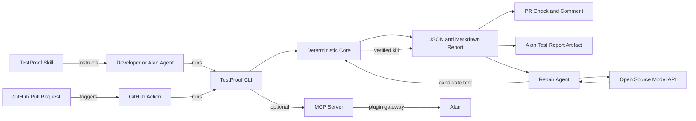
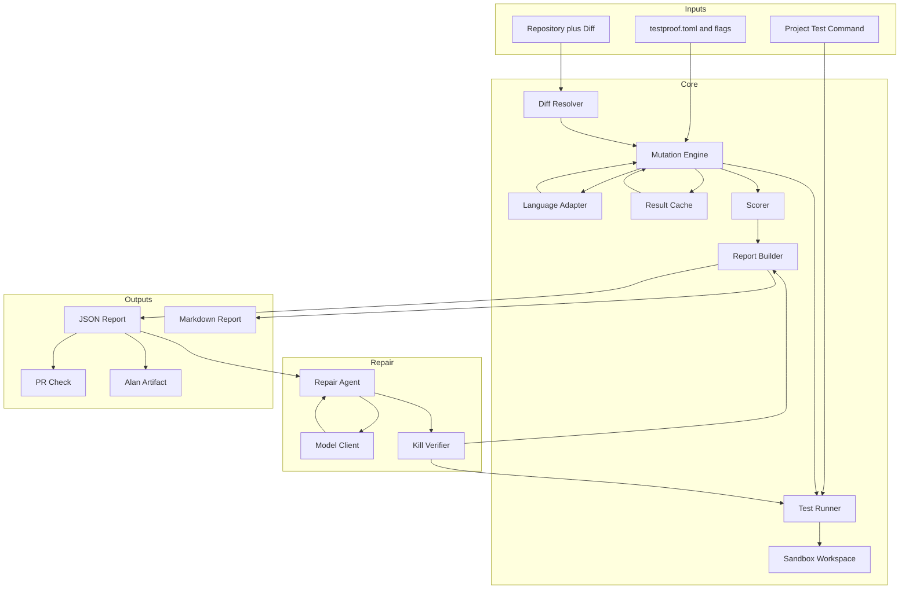
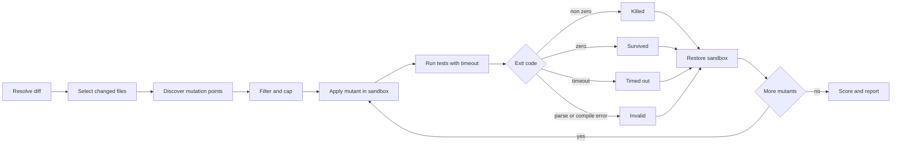
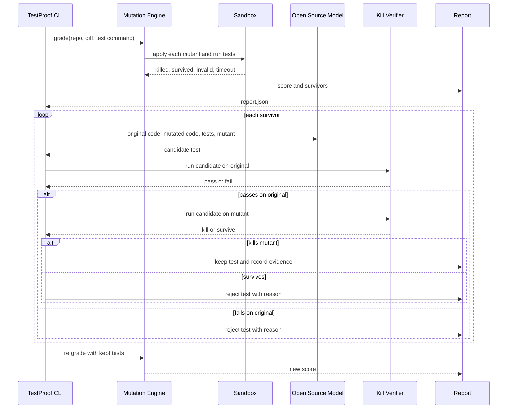
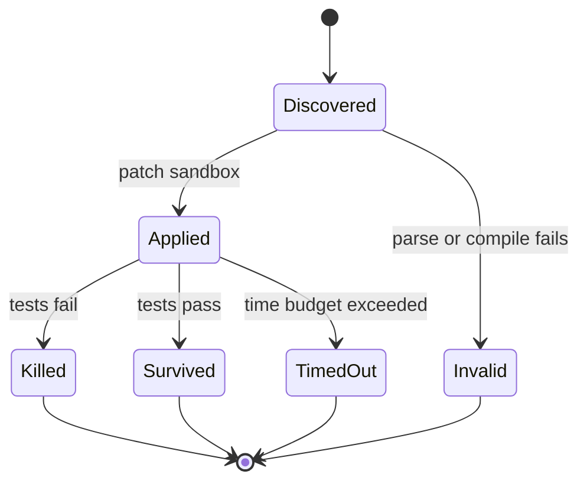

# TestProof: End to End Blueprint

Status: Draft for the Alan AI OpenFire hackathon, October 2026.

Owner: solo builder.

Working name: TestProof.

One line: TestProof grades whether a test suite actually catches bugs, writes the missing tests with an open source model, and verifies every proposed test by re running the mutant.

## 1. Executive summary

AI agents now write code and tests in the same pass. The tests pass, coverage looks healthy, and a human approves. But passing tests only prove that the code runs. They do not prove that the tests would notice if the code were wrong. TestProof closes that gap.

TestProof is a command line tool, an agent skill, and a GitHub Action. It runs mutation testing on the lines a pull request changed, scores whether the tests kill the planted bugs, and reports the survivors. Then an open source model writes one test per survivor. The deterministic engine re runs the mutant and keeps the test only if it kills the mutant and passes on the original code. The score rises, the pull request turns green, and the report becomes evidence in Alan.

The product is not a new mutation algorithm. Mutation testing is decades old and is used at Google and Meta. The product is the workflow that makes it usable in an AI native delivery loop: diff scoped, CI native, agent friendly, Alan native, and honest about what the score does and does not prove.

## 2. Judgment

Verdict: build it, but position it correctly.

The problem is real. The evidence is strong:

- Meta built Automated Compliance Hardening, which combines LLM generated mutants with LLM generated tests, and reported that privacy engineers accepted 73 percent of generated tests. Meta's engineering post names the five barriers that kept mutation testing from scaling and explains how LLMs address them.
- Google generated almost 17 million mutants across 760,000 code changes and surfaced 2 million of them during code review, across 24,000 developers on 1,000 projects.
- A 2026 study of LLM generated test suites found that a vanilla LLM prompt reached a 53 percent mutation score on HumanEval Java, and that LLM tests often miss boundary values because they assert against training data rather than the code in front of them.
- A 2026 ISSTA replicability study warns that coverage and mutation scores are useful proxies in some settings but stop being reliable when the code under test may already be buggy. This is the key caveat: the score is a proxy, not proof of correctness.

The tool space is crowded. Stryker covers JavaScript, TypeScript, C#, and Scala. PIT covers Java. mutmut, CosmicRay, MutPy, and Mutatest cover Python. There is already a GitHub Action that runs mutmut on changed lines and comments on a pull request. So the idea is not novel at the algorithm level.

The defensible product is the integration and the verified repair loop:

1. Alan native verification. Alan already runs tests and type checks on every change. TestProof adds the missing question: are these tests strong enough?
2. Diff scoped CI. Only mutate what the pull request changed, with a mutant cap, a time budget, and a partial score when time runs out. This is what makes mutation testing usable in a normal CI loop.
3. Verified repair. The open model proposes tests, the deterministic engine proves the kill. The model cannot fake a score.
4. One report contract. JSON, Markdown, a pull request check, and an Alan test report artifact all read the same schema.
5. Adapter seam. Python ships first. JavaScript and TypeScript follow. Frameworks are handled by the project's own test command, not by the tool.

What would kill the idea:

- The fixture cannot produce a deterministic score by hour 3.
- The repair loop cannot verify a kill by hour 12.
- The benchmark shows no difference between weak tests and repaired tests.
- The Alan skill cannot be installed or run in a real session, and the GitHub Action path is also blocked.
- The tool is slower than the project's own test suite by an order of magnitude with no cap or budget.

If any of the first four happen, cut scope at the checkpoint. Do not lower the quality bar.

## 3. The problem

### 3.1 The signal problem

A green test run means the assertions that exist did not fail. It does not mean the assertions cover the behavior that matters. Coverage measures execution, not detection. A test that calls a function and ignores its return value can give 100 percent coverage and catch nothing.

### 3.2 Why AI makes it worse

When one model writes both the code and the tests, the tests tend to mirror the implementation. The model checks the cases it just wrote, not the cases that could break. Research on LLM test generation shows three recurring failures:

- Boundary blindness. The model tests values far from the boundary and misses the exact boundary.
- Training data anchoring. The model asserts what it expects from training data instead of what the code actually does.
- Weak assertions. The model asserts that a call returns something, not that it returns the right thing.

### 3.3 The approval problem

A human reviewer sees green checks, high coverage, and a clean diff. The reviewer approves. The missing test ships with the code. The bug ships later. The cost is paid by the user, not by the agent that wrote the code.

### 3.4 The Alan gap

Alan's own documentation warns against treating one green signal as full readiness. Its testing evidence guide treats passing unit tests as enough evidence for logic changes. That is the gap TestProof fills: passing tests are not the same as strong tests.

## 4. The product

### 4.1 Who it is for

- A developer using Alan to ship a change who wants proof that the tests are real.
- An Alan agent that is about to claim a task is done.
- A reviewer who needs a number, not an opinion.
- A team lead who wants a CI gate that works outside Alan too.

### 4.2 Jobs to be done

- When a pull request opens, tell me whether the tests would catch a bug in the changed lines.
- When the score is low, show me the exact missing assertions.
- When I ask for a fix, write the missing tests and prove they kill the mutant.
- When I approve, give me a report I can attach to the task and audit later.

### 4.3 Product surfaces

1. `testproof` CLI. The core product. Runs locally and in CI.
2. `skills/testproof/SKILL.md`. Teaches Alan, Claude Code, Codex, Cursor, Gemini CLI, and OpenCode when and how to run the tool.
3. GitHub Action. Runs on a pull request, posts a check and a comment, uploads the report.
4. Report artifact. JSON and Markdown, attachable to an Alan task.
5. Optional MCP server. A remote HTTPS server that exposes grade, explain, and repair tools for the Alan plugin gateway. Roadmap, not 24 hour scope.
6. Static report viewer. A demo surface for the video, not the product.

### 4.4 What it is not

- It is not a test generator that replaces human judgment.
- It is not a coverage tool.
- It is not a web app where you upload files.
- It is not a claim that a high score proves correctness.
- It is not a new mutation algorithm.

## 5. Requirements

### 5.1 Functional requirements

| ID | Requirement | Priority |
| --- | --- | --- |
| FR1 | Grade a repository against a base ref using the project's own test command | Must |
| FR2 | Mutate only files and lines touched by the diff | Must |
| FR3 | Support comparison, boolean, arithmetic, return value, and constant operators | Must |
| FR4 | Run each mutant in an isolated sandbox with a timeout | Must |
| FR5 | Classify each mutant as killed, survived, invalid, or timed out | Must |
| FR6 | Compute a mutation score and a per file breakdown | Must |
| FR7 | Emit a stable JSON report and a readable Markdown report | Must |
| FR8 | Exit non zero below a threshold | Must |
| FR9 | Repair survivors with an open source model | Must |
| FR10 | Verify every proposed test on the original and on the mutant before keeping it | Must |
| FR11 | Provide an agent skill that explains the workflow | Must |
| FR12 | Provide a GitHub Action that posts a check and a comment | Should |
| FR13 | Support a second language through an adapter | Should |
| FR14 | Expose an MCP server for the Alan plugin gateway | Could |
| FR15 | Provide a static report viewer for the demo | Could |
| FR16 | Provide a benchmark corpus and an eval runner | Must |

### 5.2 Non functional requirements

| ID | Requirement | Target |
| --- | --- | --- |
| NFR1 | Determinism | Same repo, diff, command, and seed produce the same mutant ids and score |
| NFR2 | Fixture performance | Fixture grade completes in 60 seconds or less |
| NFR3 | CI performance | Changed line grade completes in 5 minutes or reports a partial score with a reason |
| NFR4 | Safety | Working tree hash is unchanged after a grade |
| NFR5 | Isolation | No network access in engine tests, no shared state between mutant runs |
| NFR6 | Portability | Python 3.11 or newer on Linux and macOS |
| NFR7 | Observability | Structured logs, per mutant timing, and a clear error section in the report |
| NFR8 | Extensibility | A language adapter can be added without changing the engine |
| NFR9 | Security | No secrets in logs, reports, or model prompts beyond the code under test |
| NFR10 | Honesty | The report states when the score is partial, when a mutant is suspected equivalent, and what the score does not prove |

## 6. System architecture

### 6.1 Architectural style

A modular monolith in one Python package. One process, clear internal seams. This is the right shape for a 24 hour build and for a CLI product. The seams are the adapter interface, the test runner interface, the model client interface, and the report schema. A hosted service can reuse the same core later.

### 6.2 Layers

```text
CLI and configuration
        |
Application orchestration
        |
Domain core: diff, mutant, engine, score, report
        |
Seams: language adapter, test runner, sandbox, model client, cache
        |
Integrations: GitHub Action, skill, MCP server, report viewer
```

### 6.3 Module map

| Module | Responsibility | Interface |
| --- | --- | --- |
| `cli.py` | Parse commands and flags, call the application, set exit codes | `testproof grade`, `testproof repair`, `testproof report` |
| `config.py` | Load `testproof.toml`, merge flags, validate | `Config.load(path) -> Config` |
| `diff.py` | Resolve the base ref, list changed files and changed lines | `resolve_diff(repo, base) -> Diff` |
| `models.py` | Domain types and report schema | `Mutant`, `MutationPoint`, `Report`, `Summary` |
| `engine.py` | Orchestrate discovery, mutation, execution, classification, scoring | `grade(config) -> Report` |
| `adapters/base.py` | Language adapter protocol | `discover(source, changed_lines) -> list[MutationPoint]`, `apply(source, point) -> str`, `validate(source) -> bool` |
| `adapters/python.py` | Python AST adapter | Implements the protocol |
| `sandbox.py` | Create, patch, restore, and delete a sandbox copy | `Sandbox.create(repo)`, `Sandbox.patch(path, content)`, `Sandbox.restore(path)` |
| `runner.py` | Run the project test command with timeout and environment control | `run(command, cwd, timeout) -> TestResult` |
| `repair.py` | Build prompts, call the model, verify candidate tests, apply confirmed tests | `repair(report, config) -> RepairResult` |
| `report.py` | Serialize JSON, render Markdown, compute exit codes | `to_json(report)`, `to_markdown(report)` |
| `cache.py` | Cache results by file hash and command hash | `get(key)`, `set(key, value)` |
| `mcp_server.py` | Optional remote MCP surface | `grade_repo`, `explain_survivor`, `repair` |

### 6.4 Context diagram



### 6.5 Container diagram



### 6.6 Mutation pipeline



### 6.7 Repair loop



### 6.8 Mutant state machine



### 6.9 Key design decisions

- The engine never edits the real working tree. It copies the repo into a sandbox, patches the copy, runs the tests, and restores the copy from memory.
- The engine runs the project's own test command. It does not parse the test framework. This is what makes frameworks a solved problem.
- The engine mutates only changed lines by default. A full repo mode exists behind the `--all` flag, but it is not the default.
- The engine caps the number of mutants and enforces a time budget. When the budget runs out, it reports a partial score with the reason.
- The engine uses a stable ordering and a seeded id for every mutant. Two runs on the same input produce the same report, excluding timestamps.
- The model never participates in measurement. It only proposes tests. The verifier decides whether a test is kept.
- The report schema is the contract between the CLI, the GitHub Action, the skill, and the optional MCP server.

## 7. Key flows

### 7.1 CI flow

1. A pull request opens against `main`.
2. The GitHub Action checks out the repo with full history.
3. The Action runs `testproof grade --base origin/main --head HEAD --test-cmd "pytest -q" --threshold 80`.
4. TestProof resolves the diff, discovers mutants on changed lines, and caps them.
5. Each mutant runs in a sandbox with a timeout.
6. TestProof writes `testproof.json` and `testproof.md`.
7. The Action posts a check run and a pull request comment with the score, the survivors, and the report link.
8. If the score is below the threshold, the check fails.
9. The developer or agent runs `testproof repair`, verifies the tests, and pushes.
10. The Action re runs. The score passes. The check turns green.

### 7.2 Alan flow

1. A task is linked to a pull request, or an automation triggers on a GitHub event.
2. The Alan agent loads the `testproof` skill.
3. The skill runs `testproof grade` on the pull request diff.
4. The report is attached to the task as a test report artifact.
5. If the score is below the threshold, the skill runs `testproof repair`.
6. The engine verifies each proposed test and applies only the confirmed ones.
7. The skill re runs the grade and updates the artifact.
8. The agent reports the before and after score, the survivors that remain, and the exact evidence.
9. A human approves the merge with the report attached.

### 7.3 Local flow

1. The developer runs `testproof grade --base HEAD~1`.
2. The terminal shows the score, the survivors, and the suggested tests.
3. The developer runs `testproof repair --report .testproof/report.json --apply`.
4. The tool writes the verified tests to the test file and prints a diff.
5. The developer reviews the diff, runs the tests, and commits.

## 8. Data model and report schema

### 8.1 Domain types

```python
@dataclass(frozen=True)
class MutationPoint:
    id: str
    path: str
    line: int
    column: int
    end_line: int
    end_column: int
    operator: str
    original: str
    replacement: str

@dataclass
class Mutant:
    point: MutationPoint
    status: Literal["killed", "survived", "invalid", "timeout", "skipped"]
    duration_ms: int
    output: str
    suspected_equivalent: bool = False

@dataclass
class FileReport:
    path: str
    score: float
    mutants: list[Mutant]

@dataclass
class Summary:
    score: float
    killed: int
    survived: int
    invalid: int
    timeout: int
    skipped: int
    total: int
    partial: bool
    confidence: Literal["high", "medium", "low"]

@dataclass
class Report:
    schema_version: str
    tool: ToolInfo
    run: RunInfo
    summary: Summary
    files: list[FileReport]
    errors: list[str]
```

### 8.2 JSON schema example

```json
{
  "schema_version": "1.0",
  "tool": {"name": "testproof", "version": "0.1.0"},
  "run": {
    "id": "0f7c2f5e",
    "started_at": "2026-10-26T13:00:00Z",
    "duration_ms": 4120,
    "base_ref": "origin/main",
    "head_ref": "HEAD",
    "test_command": "pytest -q",
    "language": "python",
    "threshold": 80,
    "time_budget_ms": 300000,
    "max_mutants": 50
  },
  "summary": {
    "score": 62.5,
    "killed": 5,
    "survived": 3,
    "invalid": 1,
    "timeout": 0,
    "skipped": 0,
    "total": 9,
    "partial": false,
    "confidence": "high"
  },
  "files": [
    {
      "path": "shop/shipping.py",
      "score": 62.5,
      "mutants": [
        {
          "id": "m-001",
          "line": 2,
          "column": 8,
          "operator": "comparison",
          "original": ">=",
          "replacement": ">",
          "status": "survived",
          "duration_ms": 120,
          "suspected_equivalent": false,
          "suggested_test": "assert shipping_fee(50) == 0"
        }
      ]
    }
  ],
  "errors": []
}
```

### 8.3 Score definition

- Mutation score equals killed divided by the sum of killed and survived.
- Invalid, timeout, and skipped mutants are excluded from the denominator but reported.
- If the time budget runs out, `partial` is true and the score is labeled as partial.
- If the baseline test run fails, the grade aborts with an error. A broken baseline is not a score.

### 8.4 Confidence

- High: all discovered mutants were run, no invalid mutants above 10 percent, no timeouts.
- Medium: partial run, or invalid mutants between 10 and 30 percent, or one timeout.
- Low: partial run below 50 percent of discovered mutants, or invalid mutants above 30 percent.

## 9. Language adapter interface

### 9.1 Protocol

```python
class LanguageAdapter(Protocol):
    language: str
    file_extensions: tuple[str, ...]

    def discover(self, path: str, source: str, changed_lines: set[int]) -> list[MutationPoint]:
        ...

    def apply(self, source: str, point: MutationPoint) -> str:
        ...

    def validate(self, source: str) -> bool:
        ...
```

### 9.2 Python adapter

- Parse with `ast.parse`.
- Walk `ast.Compare`, `ast.BoolOp`, `ast.BinOp`, `ast.Return`, and `ast.Constant`.
- Use `lineno`, `col_offset`, `end_lineno`, and `end_col_offset` to find the exact source span.
- Apply a text splice, not a full `ast.unparse`, to preserve formatting and reduce diff noise.
- Validate the mutated source with `ast.parse` before running tests.
- Skip string constants and docstrings.
- Skip mutations inside type annotations and imports.
- Filter known equivalent patterns such as `x + 0`, `x - 0`, `x * 1`, `x / 1`, `x or False`, and `x and True`.

### 9.3 Operator set for the 24 hour build

| Family | Original | Replacement |
| --- | --- | --- |
| Comparison | `>` | `>=` |
| Comparison | `>=` | `>` |
| Comparison | `<` | `<=` |
| Comparison | `<=` | `<` |
| Comparison | `==` | `!=` |
| Comparison | `!=` | `==` |
| Boolean | `and` | `or` |
| Boolean | `or` | `and` |
| Boolean | `not x` | `x` |
| Arithmetic | `+` | `-` |
| Arithmetic | `-` | `+` |
| Arithmetic | `*` | `/` |
| Arithmetic | `/` | `*` |
| Return | `return value` | `return None` |
| Constant | `0` | `1` |
| Constant | `1` | `0` |
| Constant | `True` | `False` |
| Constant | `False` | `True` |

### 9.4 JavaScript and TypeScript adapter

Two options:

1. Wrap StrykerJS. Run `npx stryker run --mutate <changed files> --reporters json`, parse the JSON report, and normalize it into the TestProof report schema. This is fast to build and battle tested.
2. Use a shared operator table over a tree sitter parse. More work, more control, and no Node dependency in the core.

For the 24 hour build, option 1 is the stretch goal. It gives multi language credibility without reimplementing a mutation engine. The adapter seam is what matters in the demo.

### 9.5 Frameworks

The adapter never knows the framework. The project supplies a test command:

- Python: `pytest -q`, `python -m unittest`, `tox`
- JavaScript: `npm test`, `pnpm test`, `vitest run`
- Go: `go test ./...`
- Java: `mvn test`, `gradle test`
- Ruby: `bundle exec rspec`

This is the answer to "codebases use dozens of frameworks". The tool does not integrate with each framework. It runs the command the project already trusts.

## 10. Deterministic, heuristic, and agentic

The product has three layers, and the separation is the trust story.

The build and evidence method is described in full in `docs/METHODOLOGY.md`.

### 10.1 Deterministic

- Mutation point discovery.
- Mutant generation.
- Sandbox patching and restoration.
- Test execution and exit code classification.
- Score computation.
- Report serialization.

No model call is allowed in this layer. The same input must produce the same mutant ids and the same score, excluding timestamps and durations.

### 10.2 Heuristic

- Choose changed lines only.
- Prioritize boundary comparisons and boolean operators.
- Cap the mutant count.
- Enforce a time budget.
- Filter known equivalent patterns.
- Rank survivors by risk and by how often the file changed recently.

The heuristic layer decides what to measure first. It never changes what a result means.

### 10.3 Agentic

- Explain a survivor in plain language.
- Propose one minimal test per survivor.
- Decide whether a survivor is worth fixing.
- Summarize the before and after for a human.

The agent proposes. The deterministic verifier decides. A test is kept only if it passes on the original and fails on the mutant.

## 11. Scale and performance

Mutation testing is slow by nature. The product survives CI by controlling four things:

1. Diff scope. Only mutate lines the pull request touched.
2. Mutant cap. Default 50 mutants per run. A larger run is opt in.
3. Time budget. Default 5 minutes. When the budget runs out, return a partial score with a reason.
4. Parallelism and cache. Run mutants in parallel workers, each with its own sandbox. Cache results by file hash, test command hash, and adapter version.

### 11.1 Performance budget

| Stage | Budget |
| --- | --- |
| Diff resolution | 2 seconds |
| Discovery | 5 seconds |
| Per mutant test run | 30 seconds timeout |
| Total grade | 300 seconds |
| Report rendering | 1 second |

### 11.2 Test selection

The full suite runs for every mutant in the first version. This is correct and simple. It is also slow. The roadmap adds test selection by import graph and coverage:

- Parse the import graph of the changed module.
- Run only the test files that import the module, directly or transitively.
- Fall back to the full suite when the graph is incomplete.

This is a performance optimization, not a correctness requirement. Do not build it in the 24 hour window unless the fixture is already green and there is time left.

## 12. Security and safety

### 12.1 Sandbox

- Copy the repo into a temporary directory.
- Never run the test command in the real working tree.
- Restrict network access where possible.
- Set a per mutant timeout and a total time budget.
- Clean up the sandbox on success, failure, and interrupt.
- Verify the working tree hash before and after a grade.

### 12.2 Model prompts

- Send only the code under test, the tests, and the mutant. Do not send secrets, environment files, or unrelated repository content.
- Redact obvious secret patterns before sending.
- Treat model output as untrusted. Parse it, run it in the sandbox, and verify it.
- Never execute a model response directly on the host.

### 12.3 Report

- Do not include environment variables, tokens, or absolute paths that reveal the user's home directory.
- Include the command, the ref, and the tool version for reproducibility.
- Mark partial results and suspected equivalent mutants honestly.

## 13. Architecture decision records

### ADR 001: CLI first, not a web app

Status: Accepted.

Context: The product must run on every pull request, in CI, and inside an agent sandbox. A web upload does not fit any of those workflows.

Decision: Build a command line tool as the core product. A web report viewer is a demo surface only.

Alternatives: A web app with file upload. Rejected because it is manual, does not scale to hundreds of pull requests, and cannot run inside an agent sandbox.

Consequences: The CLI must be easy to install with `uvx` or `pipx`. The report must be readable in a terminal and in CI.

### ADR 002: Deterministic measurement, agentic repair

Status: Accepted.

Context: A model can write a plausible test that does not actually catch the mutant. A model must not be able to influence the score.

Decision: The mutation engine, execution, classification, and score are deterministic. The model only proposes tests. A verifier re runs each proposed test on the original and on the mutant.

Alternatives: Let the model generate mutants and score tests. Rejected because it makes the number non reproducible and easy to game.

Consequences: The repair loop is slower because every candidate test is verified. That cost is the product's credibility.

### ADR 003: Diff scoped mutation with caps and a time budget

Status: Accepted.

Context: Full repo mutation testing is too slow for a pull request.

Decision: Mutate only changed lines by default. Cap mutants at 50. Enforce a 5 minute budget. Report a partial score when the budget runs out. Offer `--all` for a standalone fixture or an explicit full repository run, never as the default.

Alternatives: Full repo mutation on every pull request. Rejected because it would take hours and be disabled by the first team that tries it.

Consequences: The score is a sample, not a proof. The report must say so.

### ADR 004: Python adapter first, adapter seam for other languages

Status: Accepted.

Context: The demo needs one language that works end to end. The product needs a path to other languages.

Decision: Build a Python AST adapter with no heavy dependencies. Define a language adapter protocol. Add JavaScript and TypeScript through Stryker as a stretch goal.

Alternatives: Build a tree sitter adapter for five languages. Rejected because it is too much for 24 hours and would produce shallow support.

Consequences: The pitch must say "Python works today, JavaScript and TypeScript are next", not "all languages".

### ADR 005: Skill and GitHub Action, not a marketplace plugin in 24 hours

Status: Accepted.

Context: Alan marketplace plugins require a remote HTTPS MCP server. Alan does not run stdio servers yet. Hosting a server that executes arbitrary test suites is a security and cost problem.

Decision: Ship a `SKILL.md` that works across Alan and other SKILL.md compatible agents, plus a GitHub Action. Treat the remote MCP plugin as a roadmap item.

Alternatives: Build a remote MCP server and submit a marketplace plugin. Rejected for the 24 hour window because hosting, sandboxing, auth, and review cannot be done safely.

Consequences: The Alan integration is real but lightweight. The demo must show the skill running in an Alan session.

### ADR 006: The report schema is the contract

Status: Accepted.

Context: The CLI, the Action, the skill, and the future MCP server all need the same data.

Decision: Define a versioned JSON report schema. Every integration reads it. The Markdown report is a rendering of the same data.

Alternatives: Each integration parses terminal output. Rejected because terminal output is unstable and human oriented.

Consequences: Schema changes need a version bump. The schema is tested with a golden file.

### ADR 007: Text splice by AST position, not full unparse

Status: Accepted.

Context: Rewriting a whole Python file with `ast.unparse` changes formatting and creates noisy diffs. It can also break tests that read source text.

Decision: Use AST node positions to splice the exact span of the mutation. Keep the rest of the file byte for byte identical.

Alternatives: `ast.unparse` the whole module. Rejected because it changes formatting and may break source based assertions.

Consequences: The adapter must handle multi line spans and encoding correctly. Tests must cover both.

## 14. Risks and mitigations

| Risk | Likelihood | Impact | Mitigation |
| --- | --- | --- | --- |
| Mutation score is treated as proof of correctness | High | High | Report the caveat, include a real bug detection eval, and never claim proof |
| Equivalent mutants inflate the denominator | High | Medium | Filter known patterns, mark suspected equivalents, allow an ignore list |
| Mutation testing is too slow for CI | High | High | Diff scope, cap, time budget, parallel workers, cache |
| The model writes tests that overfit one mutant | Medium | High | Require a pass on the original, a fail on the mutant, and human review of the diff |
| Alan integration is blocked | Medium | High | Ship the skill and the Action. Record the skill in OpenCode or Claude Code as a fallback |
| Multi language scope explodes | High | Medium | Python first. Adapter seam. JavaScript and TypeScript as stretch |
| The fixture is too small to be convincing | Medium | High | Benchmark on 10 to 20 functions with known bugs |
| The demo shows a number that is not reproducible | Medium | High | Run the demo twice, show the same score, and include the report |
| The hackathon judges want a hosted product | Medium | Medium | Provide a static report viewer and a public repo. The core product is the CLI and the Action |

## 15. Competitive landscape

| Tool | Languages | Strength | Gap TestProof fills |
| --- | --- | --- | --- |
| Stryker | JS, TS, C#, Scala | Mature, fast, good reports | No Alan integration, no verified model repair |
| PIT | Java | Mature, fast, widely used | No Alan integration, no verified model repair |
| mutmut | Python | Simple, popular | Basic reporting, no diff scoped CI gate, no repair |
| CosmicRay | Python | Flexible | Slower, no agent workflow |
| MutPy | Python | Research friendly | Less active, no CI integration |
| Mutatest | Python | Simple | Limited reporting |
| Meta ACH | Internal | LLM mutants and tests at scale | Internal, not a product for small teams |
| Google mutation at review | Internal | Massive scale | Internal |
| python-mutation-report Action | Python | Runs mutmut on changed lines | No repair, no Alan, no unified report |

Differentiation:

1. Alan native verification and evidence.
2. Verified repair loop with an open source model.
3. Diff scoped CI gate with a partial score.
4. One report contract across CLI, CI, skill, and artifact.
5. Adapter seam for several languages.

Do not claim novelty in mutation testing. Claim a better workflow for AI written code.

## 16. What ships in 24 hours

Must ship:

- Python adapter with the operator set in section 9.3.
- Diff resolution and changed line filtering.
- Sandbox, test runner, timeout, invalid detection.
- Score, JSON report, Markdown report, threshold exit code.
- Verified repair with an open source model.
- `SKILL.md`.
- GitHub Action.
- Benchmark on 10 to 20 functions.
- README, license, demo video.

Should ship:

- JavaScript or TypeScript adapter through Stryker.
- Static report viewer.
- Caching and parallel workers.

Could ship:

- Remote MCP server and Alan marketplace plugin.
- Go or Java adapter.
- Test selection by import graph.

Do not ship:

- A web upload product.
- A full repo mutation run as the default.
- A claim that all languages are supported.
- A claim that a high score proves correctness.

## 17. Definition of done

The project is done for the hackathon when:

1. A fresh clone runs `uv sync` and `uv run testproof --version`.
2. `uv run testproof grade` on the fixture produces a score and at least three survivors.
3. A second run produces the same score and the same mutant ids.
4. `uv run testproof repair` raises the fixture score above the threshold and every kept test is verified.
5. The GitHub Action fails a pull request below the threshold and passes it above the threshold.
6. The skill runs in an Alan session and attaches a report artifact.
7. The benchmark shows a before and after mutation score and a before and after bug detection rate.
8. The demo video is under 3 minutes and shows the problem, the grade, the repair, and the result.
9. The repo is public, licensed MIT, and the README quickstart works.
10. `make check` is green.

## 18. Cross research

The evidence for the problem and the caveats that shape the design are in `docs/CROSS_RESEARCH.md`. The short version:

- Meta and Google validate mutation testing at industrial scale.
- LLM guided test generation works, but LLM tests are boundary blind and can overfit.
- Mutation score is a proxy. The eval must include real bug detection.
- Agent skills are a real distribution channel. A `SKILL.md` can reach Alan, Claude Code, Codex, Cursor, Gemini CLI, and OpenCode.
- Alan marketplace plugins require a remote HTTPS MCP server. The skill and Action path is the correct 24 hour choice.

## 19. Glossary

See `docs/GLOSSARY.md` for mutant, mutation score, killed, survived, equivalent mutant, sandbox, diff scope, and confidence.

## 20. Build plan

See `docs/BUILD_PLAN.md` for the phase by phase plan, acceptance criteria, checkpoints, and cut lines.

## 21. Init prompt

See `docs/INIT_PROMPT.md` for the prompt to start the coding session.
