# Build Plan

This is the phase by phase plan for the OpenFire hackathon. It assumes a solo builder, a 31 hour window from Monday 1 PM IST to Tuesday 8 PM IST, and one sleep block.

## Timeline

| Phase | Window | Duration | Output |
| --- | --- | --- | --- |
| Phase 0: Foundation | Mon 13:00 to 14:30 | 1.5 hours | Repo, scaffold, fixture, CLI version, diff resolver |
| Phase 1: Deterministic engine | Mon 14:30 to 19:30 | 5 hours | Mutation, sandbox, runner, score, JSON |
| Phase 2: Report and CI gate | Mon 19:30 to 22:30 | 3 hours | Markdown, threshold, GitHub Action |
| Checkpoint 2 and sleep | Mon 22:30 to Tue 06:00 | 7.5 hours | Review, rest |
| Phase 3: Verified repair | Tue 06:00 to 11:00 | 5 hours | Model client, prompt, verifier, apply |
| Phase 3.5: Repair hardening | Tue 11:00 to 12:00 | 1 hour | Deterministic templates, probe, chained prompt, model benchmark |
| Phase 4: Alan skill and workflow | Tue 12:00 to 13:30 | 1.5 hours | SKILL.md, session recording, artifact |
| Phase 5: Benchmark and demo | Tue 13:00 to 17:00 | 4 hours | Corpus, metrics, README, video |
| Phase 6: Hardening and submission | Tue 17:00 to 19:00 | 2 hours | Fresh clone, release, submission |
| Submission buffer | Tue 19:00 to 20:00 | 1 hour | Final checks |

```mermaid
gantt
    title TestProof build window
    dateFormat HH:mm
    axisFormat %H:%M
    section Monday
    Phase 0 Foundation           :p0, 13:00, 1h30m
    Phase 1 Deterministic engine :p1, 14:30, 5h
    Phase 2 Report and CI gate   :p2, 19:30, 3h
    Checkpoint 2 and sleep       :crit, 22:30, 7h30m
    section Tuesday
    Phase 3 Verified repair      :p3, 06:00, 5h
    Phase 3.5 Repair hardening   :p35, 11:00, 1h
    Phase 4 Alan skill           :p4, 12:00, 1h30m
    Phase 5 Benchmark and demo   :p5, 13:00, 4h
    Phase 6 Hardening            :p6, 17:00, 2h
    Submission buffer            :crit, 19:00, 1h
```



## Current build status

Phases 0, 1, 2, and 3 are complete and pushed. Phase 3.5 is complete and recorded below. Phase 4 is next.

Latest pushed checkpoint: `c8edde9` (`feat: add config file support for model client`).

Checkpoint 3.5 note, 2026-10-27:

- The repair loop now runs deterministic templates before any model call. A probe executes the target function against the original and the mutant in an isolated interpreter and turns only observed differences into assertion values.
- A real repository with three modules, 19 mutants, and 12 survivors was repaired end to end. The baseline score was 36.84 percent (7 killed, 12 survived). After apply, the score was 89.47 percent (17 killed, 2 survived). The two remaining survivors are clamp comparisons with no distinguishing input and are marked likely equivalent.
- The real repository run kept 10 tests with templates, made 0 model calls, and rejected 0 candidates. Wall time was about 13 seconds.
- The fixture survivor at `shipping.py:6` is still the boundary `>=` to `>` mutation. The fixture score is 83.3 percent (5 killed, 1 survived, 6 total).
- The model prompt now uses a worked example, a four step reasoning structure, a mutation specific hint, and deterministic probe feedback when templates fail.
- The model client reads a model override, honors a configured token limit, and reports empty content as an error instead of silently returning an empty test.
- `testproof repair` supports `--model`, `--force-model`, and `--no-templates`. Template only repair still works when no model key is configured.

Checkpoint 2 note, 2026-10-27:

- Markdown reporting, threshold exit codes, JSON output, and the pull request workflow are implemented and tested.
- `uv run testproof grade --repo fixtures/shop --all --test-cmd "uv run pytest -q" --threshold 90` exits 1.
- The same command with `--threshold 80` exits 0. The fixture score is 83.3 percent (5 killed, 1 survived, 6 total).

Checkpoint 0 note:

- `uv run testproof --version` prints `testproof 0.1.0`.
- `uv run testproof diff` compares `HEAD` to the working tree, including staged and untracked files.
- `uv run testproof diff --base HEAD~1` includes the previous commit plus the working tree.
- `uv run testproof diff --base origin/main --head HEAD` compares committed revisions only.
- The Phase 0 `make check-full` was green at its checkpoint: 24 tests, 86.98 percent coverage, security clean, fixture green.
- The diff resolver uses the merge base and marks the worktree target as `WORKTREE` in JSON.

The first diff resolver compared commits only. It was corrected before Phase 1 because the mutation engine must grade the same change set a user sees locally and in CI.

Checkpoint 1 progress note, 2026-10-27:

- Added tests for sandbox isolation, runner outcome and timeout handling, engine scoring and error paths, CLI all files and diff scoped modes, and repeated run determinism.
- `make check-full` passes locally: 68 tests, 87.93 percent coverage, Bandit clean, fixture tests pass.
- Fixture command: `uv run testproof grade --repo fixtures/shop --all --test-cmd "uv run pytest -q" --format json`.
- Fixture result at this checkpoint: 8 killed, 1 survived, 0 invalid, 0 timed out, score 88.9 percent, not partial, high confidence. The operator set was later refined, so the current fixture result is 5 killed, 1 survived, 83.3 percent. The survivor is `shipping.py:6`, `>=` to `>`.
- Repeated runs produce the same nine mutant IDs and score. Durations and timestamps are intentionally variable.
- The sandbox copies to a temporary directory and the tests confirm the source fixture remains unchanged.
- Commit `5ccc6ef` (`feat: complete Phase 1 deterministic engine and tests`) is pushed to the private GitHub repository on `master`.

## Phase 0: Foundation

Goal: a repo that runs, a fixture with a known weak test, and a diff resolver that works.

Deliverables:

- `pyproject.toml` with project metadata, dependencies, scripts, ruff, pytest, mypy.
- `Makefile` with `check`, `test`, `lint`, `format`, `fixture`.
- `src/testproof/__init__.py` with `__version__`.
- `src/testproof/cli.py` with `testproof --version` and `testproof diff`.
- `src/testproof/diff.py` with a diff resolver.
- `fixtures/shop/` with `shipping.py` and `test_shipping.py`.
- `tests/test_diff.py`.
- `.github/workflows/ci.yml`.

Fixture:

```python
# fixtures/shop/shipping.py
def shipping_fee(order_total: int) -> int:
    if order_total >= 50:
        return 0
    return 5
```

```python
# fixtures/shop/test_shipping.py
from shipping import shipping_fee

def test_free_shipping():
    assert shipping_fee(100) == 0

def test_paid_shipping():
    assert shipping_fee(10) == 5
```

The fixture is intentionally weak. It has full line coverage and misses the boundary at 50. It is the demo's opening shot.

Tests:

- `test_diff_resolves_changed_files` using a temporary git repo.
- `test_diff_resolves_changed_lines`.
- `test_diff_handles_no_changes`.

Acceptance:

```bash
uv sync
uv run testproof --version
uv run pytest tests/test_diff.py -q
uv run testproof diff --base HEAD~1 --repo <path to a temporary git repo>
make check
```

The fixture is for mutation testing, not for diff resolution. It is not its own git repository. The diff tests create temporary repositories so they can cover modified, added, deleted, and spaced paths without polluting the fixture.

Checkpoint 0:

- `testproof --version` prints the version.
- `testproof diff` prints the changed files and line ranges.
- `make check` is green.
- If the diff resolver is not working by 14:30, use a simpler line based resolver and move on.

Cut line: if the diff parser is slow, keep the commit mode and support tracked working tree files only, skipping untracked file support. Do not mutate the working tree.

## Phase 1: Deterministic engine

Status: implementation and acceptance gates pass as of 2026-10-27. Phase 1 checkpoint `5ccc6ef` is committed and pushed to `origin/master`.

Goal: grade a Python file and produce a reproducible score with survivors.

Deliverables:

- `src/testproof/cli.py` with `grade --all` for a standalone fixture and an explicit full repository run. The default remains diff scoped.
- `src/testproof/models.py` with `MutationPoint`, `Mutant`, `FileReport`, `Summary`, `Report`.
- `src/testproof/adapters/base.py` with the adapter protocol.
- `src/testproof/adapters/python.py` with the operator set.
- `src/testproof/sandbox.py`.
- `src/testproof/runner.py`.
- `src/testproof/engine.py`.
- `src/testproof/report.py` with JSON output.
- `tests/test_python_adapter.py`.
- `tests/test_sandbox.py`.
- `tests/test_runner.py`.
- `tests/test_engine.py`.
- `tests/test_determinism.py`.

Tests:

- Discovery finds the `>=` comparison on line 2.
- Discovery ignores docstrings and string constants.
- Apply produces the expected mutated source.
- Validate rejects broken syntax.
- Sandbox patch and restore leave the working tree unchanged.
- Runner returns killed on a failing command and survived on a passing command.
- Runner returns timeout on a sleeping command.
- Engine produces the expected score on the fixture.
- Two runs produce the same score and mutant ids.

The fixture is not a git repository, so the fixture acceptance uses `--all`. The diff scoped path is covered by temporary repository tests. `--all` is opt in and never the default.

Acceptance:

```bash
uv run testproof grade --repo fixtures/shop --all --test-cmd "uv run pytest -q" --format json
uv run pytest tests/test_engine.py tests/test_determinism.py -q
make check-full
```

Expected fixture result:

- One survivor: the `>=` to `>` boundary mutant.
- Score below 100 percent.
- The report lists the survivor at line 6 with `>=` and `>`.

Checkpoint 1:

- The grade command produces a score.
- Two runs produce identical scores and mutant IDs. The comparison also confirms report fields are stable apart from timestamps, durations, and pytest output timing.
- The working tree hash is unchanged.
- If the adapter is not working by 19:30, cut arithmetic and constant operators. Keep comparison, boolean, and return.

Cut line: if the sandbox is too slow, use one sandbox per run and patch and restore in place. Do not mutate the working tree.

## Phase 2: Report and CI gate

Goal: turn the score into a gate that a pull request can use.

Deliverables:

- Markdown report renderer.
- Threshold flag and exit codes.
- `--output` flag.
- GitHub Action `action.yml`.
- `.github/workflows/testproof.yml`.
- PR comment script using `actions/github-script`.
- `tests/test_report.py`.
- `tests/test_cli.py`.

Tests:

- Exit code 0 when the score is at or above the threshold.
- Exit code 1 when the score is below the threshold.
- Exit code 2 on a usage error.
- Markdown contains the score, the survivors, and the caveat.
- JSON validates against the schema.
- Golden report test.

Acceptance:

```bash
uv run testproof grade --repo fixtures/shop --all --test-cmd "pytest -q" --threshold 90
echo $?   # 1
uv run testproof grade --repo fixtures/shop --all --test-cmd "pytest -q" --threshold 80
echo $?   # 0
uv run pytest tests/test_report.py tests/test_cli.py -q
```

Checkpoint 2:

- A pull request with the fixture fails at threshold 80 and passes at 50.
- The Action posts a comment and a check.
- The report is uploaded as an artifact.
- If the Action is blocked, ship the workflow file and a local demo.

Cut line: if the PR comment is blocked by permissions, post the report as an artifact only and document the comment step.

## Phase 3: Verified repair

Status: complete and pushed at checkpoint `a0b9f05`, with follow up commits `5aca43f` and `c8edde9`.

Goal: use an open source model to write missing tests, and keep only the tests the engine proves.

Deliverables:

- `src/testproof/repair.py`.
- `src/testproof/model.py` with an OpenAI compatible client.
- Prompt template in `src/testproof/prompts/repair.md`.
- `tests/test_repair.py`.
- `tests/test_verifier.py`.
- `--dry-run` and `--apply` flags.

Prompt contract:

- Input: file path, original source, mutated source, existing tests, mutant operator, line.
- Output: one test function, no explanation.
- Constraints: use the existing framework and imports, do not modify production code, do not assert on the mutant's exact output without a reason.

Verifier:

1. Write the candidate test to a temporary test file in the sandbox.
2. Run the test command on the original code. It must pass.
3. Apply the mutant. Run the test command. It must fail.
4. Restore the original. Run the full suite. It must pass.
5. Keep only if all three hold.

Tests:

- A candidate that passes on both is rejected.
- A candidate that fails on both is rejected.
- A candidate that passes on original and fails on mutant is kept.
- A candidate that breaks the full suite is rejected.
- Dry run does not write to the test file.
- Apply writes a valid diff.

Acceptance:

```bash
export MODEL_API_KEY=...
uv run testproof repair --report .testproof/report.json --repo fixtures/shop --test-cmd "pytest -q" --dry-run
uv run testproof repair --report .testproof/report.json --repo fixtures/shop --test-cmd "pytest -q" --apply
uv run testproof grade --repo fixtures/shop --all --test-cmd "pytest -q" --threshold 80
```

Expected result:

- At least one survivor is killed.
- The score rises above 80.
- The applied test is present in the diff and passes the full suite.

Checkpoint 3:

- The score rises from the baseline to above the threshold.
- Every kept test has a verification record.
- If the model API is blocked by 11:00, ship a deterministic boundary test template for comparison mutants and mark the model path as roadmap.

Cut line: if the model is unreliable, reduce the prompt to one mutant, one test, and no explanation. If it still fails, ship the verifier and a manual repair workflow.

## Phase 3.5: Repair hardening

Status: complete and recorded at the Phase 3.5 checkpoint.

Goal: make repair credible on a real repository, not only on the four line fixture.

Problem: a model only loop is slow, costs money, and can produce a test that looks plausible but proves nothing. The first version also failed on empty model responses and gave the reader no evidence for the assertion value.

Deliverables:

- `src/testproof/probe.py` with `module_for`, `probe_cases`, and isolated execution of function calls.
- `src/testproof/templates.py` with deterministic case generation, golden value rendering, and equivalent hints.
- `src/testproof/repair.py` with template first repair, model fallback, rejection reasons, and apply support.
- `src/testproof/model.py` with a model override, configurable token limit, and an explicit empty content error.
- `src/testproof/sandbox.py` with `isolated_env` so the sandbox imports its own copy of the project.
- `tests/test_probe.py`, `tests/test_templates.py`, and expanded repair and model tests.
- `--model`, `--force-model`, and `--no-templates` flags.

Method:

1. Build candidate inputs from the mutated line, the function signature, literals in the line, existing test calls, and generic boundary values.
2. Run the function on the original source and on the mutant in separate interpreters. The probe gives each case a timeout and never imports project code into the TestProof process.
3. Keep only cases where the original returns a literal and the mutant returns a different literal or raises.
4. Render one assertion per distinguishing case, using the observed original value as the expected value.
5. If no case distinguishes the two versions and the function looks like a clamp, mark the mutant likely equivalent and skip the model unless `--force-model` is set.
6. If templates fail on a non equivalent survivor, send the model a prompt with a worked example, the mutation hint, and the probe result.
7. Verify every candidate in the sandbox: pass on original, fail on mutant, full suite green.

Tests:

- Comparison, constant, boolean, and clamp cases produce the expected distinguishing input or equivalent hint.
- The probe reports import errors and function errors without crashing the run.
- Template repair beats the model and makes no model call when a template candidate is kept.
- A model test that does not kill the mutant is rejected with a reason.
- A likely equivalent clamp mutant skips the model.
- The model override wins over the configured model name.

Acceptance:

```bash
uv run pytest -q
uv run testproof repair --repo <real repo> --report <baseline report> --test-cmd "pytest -q" --dry-run
uv run testproof repair --repo <real repo> --report <baseline report> --test-cmd "pytest -q" --apply
uv run testproof grade --repo <real repo> --base <baseline ref> --test-cmd "pytest -q"
```

Real repository result, 2026-10-27:

| Stage | Killed | Survived | Score | Model calls |
| --- | --- | --- | --- | --- |
| Baseline | 7 | 12 | 36.84 percent | 0 |
| After verified repair | 17 | 2 | 89.47 percent | 0 |

The repository had three modules (`calculator.py`, `validator.py`, `formatter.py`) and 19 mutants. The repair kept 10 tests, rejected 0 candidates, marked 2 mutants likely equivalent, and ran in about 13 seconds. Both remaining survivors are clamp comparisons (`>=` to `>` and `<=` to `<`) with no valid range that distinguishes the original from the mutant.

Limits of the evidence:

- One real repository is not a corpus. Phase 5 must repeat this on at least ten modules.
- Templates cover common operator shapes. A survivor outside those shapes still depends on the model fallback.
- Likely equivalence is a heuristic, not a proof. The report keeps the survivor and labels it instead of hiding it.

The model fallback is measured separately in `docs/MODEL_BENCHMARK.md`. The benchmark ran seven OpenRouter models on the same 12 survivors with `--no-templates`. `qwen/qwen3-235b-a22b-2507` kept 9 of 10 killable survivors for under one cent, so it is the default in `src/testproof/model.py`. Free tiers and reasoning heavy models are not suitable defaults at the 1200 token cap.

Checkpoint 3.5:

- A real repository score rises by more than 50 points with verified tests.
- Every kept test has a verification record.
- Template repair works with no model key configured.
- The model fallback is measured separately so its quality and cost are known.
- If templates are slow, cap the case count and cap the probe timeout. Do not remove verification.

Cut line: if the probe cannot import a module, keep the model fallback and record the import error. Do not weaken the verifier.

## Phase 4: Alan skill and workflow

Goal: make the tool usable from an Alan session and attach the report as evidence.

Deliverables:

- `skills/testproof/SKILL.md` with valid frontmatter.
- Install instructions for Alan, Claude Code, Codex, Cursor, Gemini CLI, and OpenCode.
- An automation recipe for Alan: trigger, instructions, artifact.
- A recorded session in `docs/DEMO.md`.
- A test report artifact template.

Skill steps:

1. Identify the repo, base ref, and test command.
2. Run `testproof grade`.
3. Read the JSON report.
4. If the score passes, attach the report and stop.
5. If the score fails, list survivors and run `testproof repair`.
6. Re grade and attach the new report.
7. Report the before and after score and the remaining survivors.

Acceptance:

- A real session runs the skill end to end on the fixture.
- The report is attached as a test report artifact.
- The session transcript shows the command, the score, the repair, and the new score.

Checkpoint 4:

- The recording exists and is under 2 minutes.
- If Alan is blocked, record OpenCode or Claude Code and document the Alan automation.

Recorded session: `docs/DEMO.md`. It runs on a copy of `fixtures/shop` with no model key configured. The score moves from 83.33 percent to 100 percent, one test is kept, and no model is called. The artifact is included in the document.

Cut line: if the skill cannot be installed in Alan, ship it as a portable skill with a manual install and a recorded OpenCode session.

## Phase 5: Benchmark and demo

Goal: prove the tool works beyond the fixture and produce the submission artifacts.

Deliverables:

- `benchmark/corpus/` with 10 to 20 Python modules and tests.
- `benchmark/bugs/` with known bug versions.
- `benchmark/run.py` with metrics.
- `benchmark/results.md`.
- `docs/EVAL.md` updated with the results.
- `README.md` with the quickstart and the results.
- A static report viewer.
- A 2 to 3 minute demo video.
- An X post draft.

Metrics:

- Mutation score before repair.
- Mutation score after repair.
- Bug detection rate before repair.
- Bug detection rate after repair.
- Repair acceptance rate.
- Runtime.

Acceptance:

```bash
uv run python benchmark/run.py --corpus benchmark/corpus --bugs benchmark/bugs --output benchmark/results.md
```

Checkpoint 5:

- The benchmark table shows a clear before and after.
- The demo video shows the problem, the grade, the repair, and the result.
- The README quickstart works from a fresh clone.

Cut line: if the corpus takes too long, reduce to 10 functions and run with a 5 minute budget per module. Report the partial result honestly.

## Phase 6: Hardening and submission

Goal: a fresh clone works, the repo is public, and the submission is complete.

Deliverables:

- Error messages for common failures: no git repo, no changed files, baseline test failure, missing model key, timeout.
- `LICENSE` MIT.
- `CHANGELOG.md` with the version.
- Release tag `v0.1.0`.
- Public GitHub repo.
- X post with the demo video.
- Submission form with the working link, the repo, and the video.

Acceptance:

```bash
git clone <repo> /tmp/testproof-fresh
cd /tmp/testproof-fresh
uv sync
uv run testproof --version
uv run pytest -q
uv run testproof grade --repo fixtures/shop --all --test-cmd "pytest -q"
```

Checkpoint 6:

- The fresh clone works.
- The CI is green.
- The demo video is uploaded.
- The X post is live.
- The submission form is submitted before 10 PM IST.

Cut line: if the time is short, submit the repo, the video, and the CLI. Do not wait for the optional viewer.

## Checkpoint summary

| Checkpoint | When | Gate | If it fails |
| --- | --- | --- | --- |
| CP0 | Mon 14:30 | CLI version and diff resolver work | Simplify diff, move on |
| CP1 | Mon 19:30 | Fixture score is deterministic | Cut operator families |
| CP2 | Mon 22:30 | PR gate fails and passes correctly | Ship local CLI and workflow file |
| CP3 | Tue 11:00 | Repair raises the score with verified tests | Ship grader plus manual repair |
| CP3.5 | Tue 12:00 | Real repo repair is credible and measured | Ship template repair and document the model fallback |
| CP4 | Tue 13:30 | Skill runs in a real session | Record OpenCode and document Alan |
| CP5 | Tue 17:00 | Benchmark and video are ready | Use 10 functions and a shorter video |
| CP6 | Tue 19:00 | Fresh clone and submission are ready | Submit the minimum three artifacts |

## Do not build in 24 hours

- A web upload product.
- A hosted remote MCP server.
- A marketplace plugin submission.
- A full repo mutation run as the default.
- An LLM mutant generator.
- Test selection by import graph.
- A database.
- A user account system.
- A dashboard with authentication.
- A custom test framework parser.

## Definition of done

The build is done when all ten items in `docs/BLUEPRINT.md` section 17 are true.
